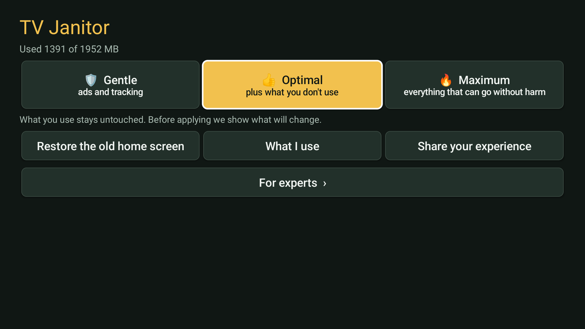
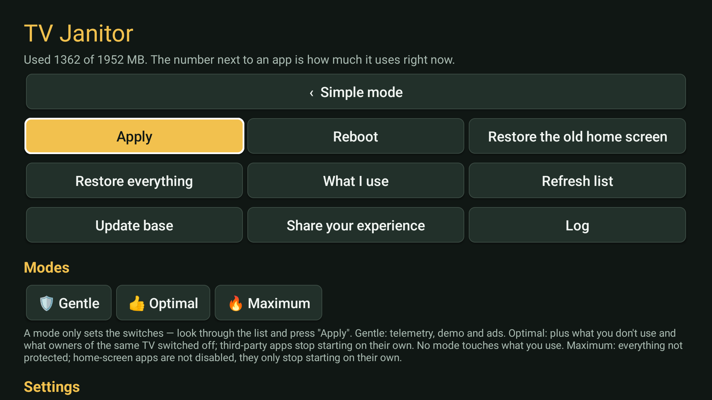

# TV Janitor

***Your TV, your choice — even after a reboot.***

**Clean any Android TV or Google TV on the TV itself, no computer needed after setup.**
TV Janitor asks what you use, switches off what you don't, can put a clean home screen in place, and does it
all again after every boot, because some firmware switches packages back on by itself. Built on the data and
the launcher of [CleanYourTV](https://github.com/Gathin23/cleanyourtv).

**No AI agent, no subscription, no computer after setup:** install the APK once with `adb`, and the cleanup
runs on the TV itself.

> **0.9 beta.** Tested on three TVs so far. Every TV is different: read "Things to know" first.
> Speaks the TV's language: English, Russian, Ukrainian, German, French, Spanish, Portuguese, Turkish, Chinese,
> Japanese and Vietnamese (other languages fall back to English). Translations: [tools/i18n](tools/i18n).

[Русский ниже](#tv-janitor-по-русски)

<p align="center">
  
  
</p>

## How it started

I cleaned up an old 32-inch Novex with Yandex TV: switched off the voice engine, the preloaded streaming
apps, the telemetry. It got faster. Then I rebooted it, and everything was back. The firmware quietly switches
every disabled package on again at each boot, and a script run once from a laptop can't argue with that.

So the cleaner moved onto the TV itself. It remembers what you chose and puts it back after every boot, and
then it grew into something that works on any Android TV: it asks what you use, knows what not to touch, and
undoes everything with one button. — *Marginalion*

## Two editions

| | **Lite** | **Full** |
|---|---|---|
| Screen | one button | three modes + "For experts" with the whole list |
| Switches off | only packages someone knows about (described, in CleanYourTV's base, or a feature you said you don't use) | also guesses by name, and anything you pick by hand |
| Internet | never used (the built-in base only) | updates the base from GitHub |
| Undo | "Restore everything" | the same, plus per-app control |

Both are the same app (`io.github.marginalion.tvjanitor`), so one installs over the other and keeps your choices.
Android still lists the INTERNET permission for Lite: it is needed for the app's own connection to the TV's
ADB at 127.0.0.1. Lite never goes online: its build switches off the base update.

## What it does

- **"What do you use?"** on first start: voice search, aerial TV, HDMI, casting, screen mirroring, USB
  media, photo screensaver, updates, browser, music, smart home, games, app stores, accessibility. What you
  use is never touched.
- **Simple screen**: Gentle (telemetry, demo, ads), Optimal (plus what you don't use and what owners of the
  same TV switched off), Maximum (everything not protected; home-screen apps only stop starting on their
  own). Each shows what will change before it applies, and offers a reboot afterwards.
- **Warnings that matter**: if the new home screen isn't installed (the stock one may depend on what gets
  switched off), and if no app store would be left.
- **For experts** (Full): every app with its memory use, three states per row (works → doesn't start on its
  own → disabled), groups ✅ Recommended / ❓ Your choice / ❔ Unknown / ⚠ Important.
- **Knows what matters on any TV**: TV inputs, keyboards, accessibility services (remote keys often live
  there), persistent services, remote and Bluetooth, factory menus, setup wizards, firmware overlays. Android's
  core never appears and is never changed.
- **CleanYourTV's base of ~300 TVs**: matches your model and shows what owners of the same TV did.
- **Safe apply**: batches of five, a look at the crash log after each; a batch that starts a crash loop is
  put back by itself.
- **Restore everything** to the snapshot taken at first start; a report after every boot.
- **New home screen**: CleanYourTV's launcher, checked against its SHA-256 before install.
- **Share your experience** (opt-in, off by default): a report in CleanYourTV's `debloat.txt` format. Nothing
  is sent anywhere by the app.
- Leaves nothing behind: about 0 MB when closed.

How every decision is made, rule by rule: **[docs/HOW-IT-DECIDES.md](docs/HOW-IT-DECIDES.md)**.

## Install

**Ready-made APK:** download `TVJanitor-0.9-beta-lite.apk` or `TVJanitor-0.9-beta-full.apk` from
[Releases](../../releases) and check it against `SHA256SUMS.txt`. Release signing certificate SHA-256:
`f31e30d17e8abe262c05b8fd86945fe7038e3c75b664badeec3e746e10a44580`.

On the TV: Developer options (press OK seven times on Build number) → USB debugging on, and network debugging
if there is one. From a computer on the same Wi-Fi:

```sh
adb connect <tv ip>
adb install -r TVJanitor-0.9-beta-lite.apk
adb shell am start -n io.github.marginalion.tvjanitor/.MainActivity
```

On the TV, allow "USB debugging" for the app and tick "Always allow".

**The easy way:** paste [PROMPT.md](PROMPT.md) into an AI coding assistant (Claude Code, Codex…) with your
TV's model and IP. It backs up, installs, checks and writes you a restore script.

**Build it yourself:** `tools/build.sh` (Windows: `tools\build.ps1`; JDK 17+, Android SDK 34). The repository
holds no binaries: the build fetches CleanYourTV at a pinned commit and applies
`patches/cleanyourtv-launcher.patch`. Without a `keystore.properties` the build is signed with your local
debug key; such a build can't update the official release in place.

## Things to know

- **Network ADB stays on.** That is how the app works without a computer. Anyone who reaches port 5555 still
  needs your approval on the screen, unless the firmware has `ro.adb.secure=0`; the app warns about that.
  To take the app's access away: Developer options → Revoke USB debugging authorisations.
- Android 8.0 (API 26) or newer. Not for LG webOS, Samsung Tizen, Hisense VIDAA or Fire TV.
- Tested on: Novex NVX-32H219MSY (Yandex TV, Android 9, HiSilicon, 1 GB), Novex NWX-32H171MSY (Yandex TV,
  Android 9, MediaTek, 1 GB), Xiaomi Mi TV 4A (Android 11, 2 GB). Philips is next.
- "Nearly the same" TVs can differ a lot inside: compare a TV with itself before and after, not with another TV.
- You use it at your own risk (see the warnings in the app and [LICENSE](LICENSE)).

## Tell us how it went

Tried it? Open an issue: **[My TV](../../issues/new?template=1-tv-report.yml)** (how it did on your model),
**[Something went wrong](../../issues/new?template=2-bug.yml)**, or **[I want to test](../../issues/new?template=3-beta-tester.yml)**
new versions on a TV we don't have. Russian is fine. For a list your TV's owners can reuse, also send it to
[CleanYourTV's `examples/`](https://github.com/Gathin23/cleanyourtv/tree/main/examples).

## How it was made

Conceived, designed and tested on real TVs by **Marginalion**. The code was written together with
[Claude](https://claude.ai) (Anthropic) in conversation: the human decided what to build and why, the AI how
to program it. Data and the home screen come from [CleanYourTV](https://github.com/Gathin23/cleanyourtv).

## Legal

- TV Janitor is an independent open-source project. It is not affiliated with, endorsed by or sponsored by
  any TV maker or platform. Brand and model names only say which TV something was tested on and remain the
  trademarks of their owners.
- It works only through settings the TV offers its owner: Developer options, ADB debugging and Android's own
  `pm disable-user`, the same switch as Settings > Apps > Disable. It does not root the TV, flash firmware,
  or bypass any lock, DRM or copy protection, and the repository contains no manufacturer software.
- Nothing is uninstalled, and "Restore everything" puts it back. You run it on a TV you own, at your own
  risk; changing a TV's software may affect its warranty or support.

## Licence and credits

MIT, see [LICENSE](LICENSE). The bundled launcher (modified) and the hint base come from
[CleanYourTV](https://github.com/Gathin23/cleanyourtv), MIT, see [NOTICE](NOTICE).

---

# TV Janitor по-русски

***Твой телевизор помнит твой выбор — даже после перезагрузки.***

**Как это началось.** Я почистил старый 32-дюймовый Новекс с Яндекс ТВ: отключил голосовой движок,
предустановленные кинотеатры, телеметрию. Он стал быстрее. Потом я его перезагрузил, и всё вернулось:
прошивка при каждой загрузке молча включает отключённое обратно, и скрипт, один раз запущенный с ноутбука,
с этим не поспорит. Поэтому уборщик переехал на сам телевизор: он помнит твой выбор и возвращает его после
каждой загрузки. А потом вырос в приложение для любого Android TV: спрашивает, чем ты пользуешься, знает,
что трогать нельзя, и всё отменяет одной кнопкой. — *Marginalion*

**Чистит любой телевизор на Android TV или Google TV прямо на нём самом, после установки компьютер не
нужен.** Спрашивает, чем вы пользуетесь, отключает лишнее, может поставить чистую оболочку и повторяет всё
после каждой загрузки: некоторые прошивки сами включают пакеты обратно. В приложении оно называется
«Уборщик». **Без ИИ, без подписки и без компьютера после установки:** один раз ставите APK через `adb`, дальше всё работает на самом телевизоре. **Версия 0.9 бета.** Говорит на языке телевизора: 11 языков, остальные — по-английски.

**Две версии.** **Lite** — одна кнопка, отключает только то, про что точно известно, что оно лишнее, и
ничего не скачивает из интернета. **Full** — три режима («Бережно», «Оптимально», «Максимум»), экран «Для
опытных» со всем списком, обновление базы. Это одно приложение: одна версия ставится поверх другой.

**Возможности:** вопросы «Чем вы пользуетесь?»; перед применением видно, что изменится; предупреждения, если
не стоит новая оболочка или не останется ни одного магазина; автоопределение важного (входы, клавиатура,
пульт, системные службы, оверлеи прошивки); ядро Android не трогается никогда; база CleanYourTV примерно на
300 телевизоров; применение порциями с автооткатом; «Вернуть всё как было»; отчёт после загрузки; новая
оболочка с проверкой SHA-256; «Поделиться опытом» только по вашему согласию.

**Как Уборщик решает, что трогать:** по шагам и по-русски — в [docs/HOW-IT-DECIDES.md](docs/HOW-IT-DECIDES.md#как-уборщик-принимает-решения).

**Установка:** скачайте APK со страницы [Releases](../../releases) и сверьте с `SHA256SUMS.txt`, затем
команды из раздела «Install» выше. Или вставьте [PROMPT.ru.md](PROMPT.ru.md) в ИИ-помощника.

**Обратная связь.** Попробовали? Откройте issue: [Мой телевизор](../../issues/new?template=1-tv-report.yml),
[Что-то пошло не так](../../issues/new?template=2-bug.yml) или [Хочу тестировать](../../issues/new?template=3-beta-tester.yml).
Можно по-русски.

**Как сделан.** Задумано, спроектировано и проверено на живых телевизорах — **Marginalion**. Код написан
вместе с [Claude](https://claude.ai) (Anthropic) в разговоре: человек решал, что и зачем делать, ИИ — как это
запрограммировать. Данные и оболочка — [CleanYourTV](https://github.com/Gathin23/cleanyourtv).

**Правовое.** Независимый проект, не связан ни с одним производителем. Работает только через настройки,
которые телевизор сам даёт владельцу (режим разработчика, отладка, обычное «Отключить» из Android), ничего
не удаляет, не взламывает и не обходит защиту. Пользуетесь на своём телевизоре и на свой риск.

**Важно:** отладка по сети остаётся включённой, так приложение работает без компьютера. Нужен Android 8.0
или новее. Не для LG webOS, Samsung Tizen, Hisense VIDAA и Fire TV. Пользуетесь на свой риск. Лицензия MIT;
оболочка и база взяты из CleanYourTV (MIT), см. [NOTICE](NOTICE).
